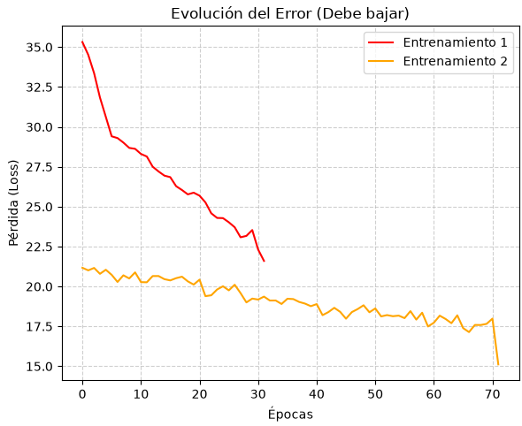
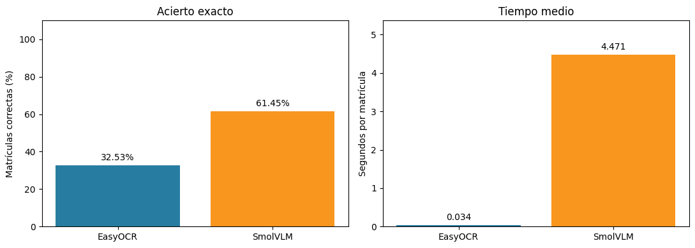

## Práctica 4. Detección de vehículos y matrículas

## Autores: José Miguel Ojeda Hernández (GitHub: https://github.com/JoseOjeda14) y Yenedey Morán Delgado (GitHub: https://github.com/Yenedey36)

## Descripción del Proyecto
El objetivo de esta práctica abarca desde el procesamiento de vídeo para la detección y seguimiento (tracking) de personas y vehículos, hasta la extracción y lectura del texto de las matrículas comparando distintos modelos de OCR.


## 🟢 PARTE 1: Primera Entrega (Detección y Tracking)

### 🔗 Entregables Principales (Parte 1)

* **Vídeo Final:**

https://github.com/user-attachments/assets/9e4a6d83-532b-4ec7-90a9-b524e537e58f

Como se puede ver en el vídeo, la técnica basada en contornos resulta ser un método que comete más errores en comparación con el modelo de RT-DETR. Esto ocurre porque los algoritmos clásicos no entienden el contexto de lo que están viendo; se limitan exclusivamente a buscar contrastes de píxeles que formen polígonos de 4 lados con proporciones de rectángulo. Debido a esto, el sistema de contornos genera una alta tasa de falsos positivos, confundiendo frecuentemente faros traseros, rejillas de los vehículos o los parabrisas. Por el contrario, RT-DETR extrae características semánticas profundas, logrando identificar de forma más precisa la matrícula real independientemente de las condiciones de luz, el ángulo o la resolución.

Para llevar el registro del total de vehículos y personas que aparecen en el vídeo, el sistema se apoya directamente en la memoria del algoritmo de seguimiento. Se ha implementado una estructura de datos de tipo conjunto que almacena los identificadores únicos asignados a cada objeto. De esta forma, aunque la red neuronal detecte el mismo coche durante cientos de fotogramas, su ID se registra únicamente la primera vez que entra en escena.Garantizando un conteo acumulativo exacto, evitando que un mismo objeto sea sumado múltiples veces.

Por último para determinar la dirección de los vehículos, se evalúa la memoria espacial de sus centroides sobre el eje Y. El sistema registra la coordenada Y exacta donde un objeto es detectado por primera vez. En cada fotograma, se calcula el vector de desplazamiento restando la posición inicial a la actual: si el valor es fuertemente positivo, el objeto baja por la pantalla, se acerca al Frente, si es fuertemente negativo, el objeto sube, se aleja hacia el Fondo.


*(Nota: En este primer vídeo solo se detectan las matriculas y las 3 tareas extras realizadas, las cuales se explicaran más adelante, por un tema de rendimiento, el vídeo de la deteccion de los caracteres de la matrícula estará más adelante).*
* **Archivo de tracking (CSV):** En `resultados_tracking.csv` se encuentran las detecciones frame a frame de los distintos objetos del video. *(Nota: El texto de la matrícula se rellena en la Parte 2).*
* **Dataset de Matrículas:** https://drive.google.com/drive/folders/1RFd6sKH_QMQcpE_w5rWmy8rKiYUY5_SI

### Tareas Completadas
- Detección y seguimiento de personas y vehículos (clases: `person, car, motorcycle, bicycle, bus, truck, boat, matricula`).
- Detección de matrículas integradas en el pipeline mediante IA.
- Conteo total de objetos detectados por clase a lo largo del vídeo.
- Volcado de datos estructurado en CSV.

### ⭐ Puntos Extra Implementados
1. **Determinación de Flujo:** Implementación de memoria espacial en el eje Y para determinar la dirección. El sistema muestra si los vehículos/personas se están **Acercando** o **Alejando** y contabiliza su paso al cruzar márgenes establecidos en la calzada.

```python
cy = (y1 + y2) // 2 #Centro vertical

            if track_id not in posicion_inicial:
                posicion_inicial[track_id] = cy

            desplazamiento_y = cy - posicion_inicial[track_id]
            
            direccion = "Fijo"
            if desplazamiento_y > 30: 
                direccion = "Frente" 
            elif desplazamiento_y < -30:
                direccion = "Fondo"  

            linea_fondo = 350 
            linea_frente = 400

            if track_id not in ids_contados_flujo:
                if direccion == "Frente" and cy > linea_frente:
                    flujo["Frente"] += 1
                    ids_contados_flujo.add(track_id)
                elif direccion == "Fondo" and cy < linea_fondo:
                    flujo["Fondo"] += 1
                    ids_contados_flujo.add(track_id)
```

2. **Anonimización:** Sistema de pixelado sobre las áreas (ROIs) de personas y vehículos para proteger la privacidad.

```python
if nombre_clase in clases_permitidas:
                y1_safe, y2_safe = max(0, y1), min(height, y2)
                x1_safe, x2_safe = max(0, x1), min(width, x2)
                
                roi = img[y1_safe:y2_safe, x1_safe:x2_safe]
                
                if roi.size != 0:
                    w_roi = x2_safe - x1_safe
                    h_roi = y2_safe - y1_safe
                    roi_small = cv2.resize(roi, (max(1, w_roi//12), max(1, h_roi//12)), interpolation=cv2.INTER_LINEAR)
                    roi_blurred = cv2.resize(roi_small, (w_roi, h_roi), interpolation=cv2.INTER_NEAREST)
                    
                    img[y1_safe:y2_safe, x1_safe:x2_safe] = roi_blurred
```

3. **Técnicas de Contornos para Matrículas:** Función matemática tradicional (`Canny` + `GaussianBlur` + `findContours`) que busca proporciones de matrícula. Se dibuja en **ROJO** ("Mat. Contorno") para compararla visualmente con la precisión del modelo RT-DETR.

```python

def detectar_matricula_contornos(roi_coche):

    gris = cv2.cvtColor(roi_coche, cv2.COLOR_BGR2GRAY)
    gris = cv2.GaussianBlur(gris, (5, 5), 0)
    bordes = cv2.Canny(gris, 30, 200)
    
    contornos, _ = cv2.findContours(bordes, cv2.RETR_TREE, cv2.CHAIN_APPROX_SIMPLE)
    
    contornos = sorted(contornos, key=cv2.contourArea, reverse=True)[:10]
    
    for c in contornos:
        perimetro = cv2.arcLength(c, True)
        aproximacion = cv2.approxPolyDP(c, 0.018 * perimetro, True)
        
        if len(aproximacion) == 4:
            x, y, w, h = cv2.boundingRect(aproximacion)
            aspect_ratio = w / float(h)
            
            if 2.5 <= aspect_ratio <= 5.5:
                return aproximacion 

    return None
```

### Entrenamiento del Modelo (RT-DETR)
Se realizó un *fine-tuning* sobre RT-DETR, conservando las 9 primeras clases de COCO y mapeando la matrícula en el ID 9. 

* **Función de Pérdida (Train Loss):** Descenso pronunciado en las primeras épocas y estabilización progresiva hacia el final del ciclo (época 71), indicando un aprendizaje correcto sin sobreajuste.

> 

* **Métrica de Precisión (mAP):** Mejora continua del mAP@0.5:0.95 alcanzando picos estables, lo que se traduce en una mayor confianza durante la inferencia en el vídeo de test.

> 

## PARTE 2: Lectura de matrículas y comparativa

### Objetivo

En esta parte se añade la lectura del texto de las matrículas al sistema de detección y seguimiento. Además, se comparan dos modelos: EasyOCR, como OCR especializado, y SmolVLM, como modelo de lenguaje visual.

El trabajo se divide en dos tareas: evaluar ambos modelos sobre los mismos recortes de matrículas e integrar la lectura con SmolVLM en el vídeo de prueba.

### Archivos y resultados

- Vídeo final con lectura de matrículas (https://drive.google.com/file/d/1ER0DJJZit2SnG0PboLaL9HDeef3-shPu/view?usp=sharing).


### Modelos utilizados

**EasyOCR**

El modelo devuelve los fragmentos de texto detectados y sus posiciones. Estos fragmentos se ordenan por filas y de izquierda a derecha para formar una lectura de la matrícula.

**SmolVLM**

Se utiliza el modelo preentrenado `HuggingFaceTB/SmolVLM-Instruct`, cargado mediante la biblioteca Transformers.

El modelo recibe el recorte de la matrícula y una instrucción para devolver únicamente sus letras y números, sin explicaciones. Se limita la generación a 32 tokens y se desactiva el muestreo.

No se ha realizado entrenamiento adicional de ninguno de los dos modelos de lectura.

### Preparación de la muestra

La evaluación se realizó sobre **83 matrículas con transcripción de referencia válida**.

Las imágenes se emparejaron con sus archivos JSON por el nombre del archivo. Cada anotación proporciona la posición de la matrícula y su texto real. Una imagen puede contener varias matrículas, por lo que el número de recortes no tiene por qué coincidir con el número de fotografías.

Las coordenadas de las anotaciones tienen el formato:

`[centro_x, centro_y, ancho, alto]`

Estos valores están normalizados respecto al tamaño de la imagen. Se convierten a píxeles para extraer cada matrícula.

Las anotaciones sin texto de referencia, como `"None"`, se excluyen del cálculo de acierto. Las matrículas borrosas con una referencia válida se mantienen en la evaluación.

Para hacer reproducible la selección se utiliza una semilla de 42. El número de imágenes evaluadas y los parámetros de la ejecución se registran en `condiciones_experimento.json`.

### Condiciones de la comparación

Ambos modelos reciben exactamente los mismos recortes. Cuando un recorte tiene menos de 64 píxeles de alto, se amplía conservando su proporción.

Se aplica la misma normalización a las referencias y a las predicciones: conversión a mayúsculas y eliminación de caracteres distintos de letras y números. No se sustituyen letras por números ni se corrigen las respuestas utilizando la matrícula real.

Antes de medir se realiza una ejecución de calentamiento por modelo. La carga inicial y la descarga de los modelos quedan fuera de los tiempos.

El tiempo medido comienza con el recorte en memoria y termina al obtener el texto normalizado. Incluye el preprocesamiento propio del modelo, la inferencia y la conversión de la salida a texto. No incluye la lectura del archivo, la extracción y ampliación del recorte ni el guardado de resultados.

Se sincroniza la GPU antes y después de cada medición y se alterna el orden de ejecución de los modelos.

### Equipo utilizado

La evaluación se ejecutó en Google Colab.

- **GPU:** T4, alta capacidad de RAM.

### Métricas

Se utilizan las siguientes métricas:

- **Acierto exacto:** porcentaje de matrículas cuya predicción normalizada coincide completamente con la referencia. Si un solo carácter es incorrecto, la lectura cuenta como fallo.
- **Tiempo medio de inferencia:** media de los segundos necesarios para procesar una matrícula.

En el CSV individual, las columnas de acierto toman el valor `1` cuando la lectura coincide con la referencia y `0` cuando no coincide.

### Resultados de la comparativa

| Modelo | Matrículas evaluadas | Matrículas correctas | Acierto exacto | Tiempo medio por matrícula |
|---|---:|---:|---:|---:|
| EasyOCR | 83 | 27 | 32,53 % | 0,0368 s |
| SmolVLM | 83 | 51 | 61,45 % | 4,8326 s |

IMAGEN DE GRAFICAS COMPARATIVAS

> 

#### Tiempo de inferencia

EasyOCR fue considerablemente más rápido: necesitó una media de 0,0368 segundos por matrícula, frente a los 4,8326 segundos de SmolVLM. En esta ejecución, SmolVLM tardó aproximadamente 131 veces más.

Estos tiempos corresponden a la lectura de recortes, no al procesamiento completo del vídeo. La detección, el seguimiento y la escritura del vídeo tienen un coste adicional.

#### Tasa de acierto

SmolVLM reconoció correctamente 51 de las 83 matrículas, mientras que EasyOCR acertó 27. La diferencia fue de 28,92 puntos porcentuales a favor de SmolVLM.

Ambos modelos produjeron errores. Entre las dificultades observadas se encuentran las matrículas pequeñas, los caracteres borrosos y las lecturas incompletas. También se observaron caracteres añadidos y confusiones entre letras.

Los resultados describen esta muestra y estas condiciones de ejecución; no permiten asegurar el mismo rendimiento con cualquier vídeo o conjunto de imágenes.

### Integración de SmolVLM en el vídeo

Se utilizó SmolVLM para la lectura del vídeo porque obtuvo el mayor acierto en la comparativa, aceptando un tiempo de procesamiento superior.

Se reutilizaron los detectores RT-DETR de la primera parte: uno para personas y vehículos y otro entrenado para detectar matrículas. Para el detector de matrículas se empleó el checkpoint `best.pth`.

El procesamiento sigue estos pasos:

1. Detectar personas, vehículos y matrículas en cada fotograma.
2. Asignar identificadores mediante seguimiento por proximidad entre centros y coincidencia de clase.
3. Asociar cada matrícula al vehículo de menor área que contiene su centro.
4. Extraer el recorte desde el fotograma original, antes de dibujar las cajas.
5. Seleccionar recortes y realizar consultas espaciadas a SmolVLM.
6. Elegir una lectura entre las predicciones obtenidas para cada identificador.
7. Dibujar los resultados y guardar las detecciones y lecturas en el CSV.

Las matrículas que no pueden asociarse a un vehículo se siguen por separado.

### Selección de recortes y lecturas

Para no consultar al VLM en todos los fotogramas, se utiliza un intervalo mínimo de 10 fotogramas entre consultas y un máximo de 8 lecturas por identificador.

Se admiten recortes de al menos 24 píxeles de ancho y 7 de alto. Entre consultas se conserva el recorte con mayor puntuación visual, calculada a partir de su tamaño, contraste y variación del Laplaciano como indicador de nitidez.

Las primeras tres consultas permiten reunir distintas observaciones. Después se realizan nuevos intentos cuando mejora el tamaño o la puntuación visual del recorte, o cuando una lectura no supera el filtro y ha transcurrido una pausa.

Las predicciones candidatas deben tener entre 4 y 12 caracteres, contener algún dígito y presentar al menos tres caracteres distintos. Este filtro descarta algunas respuestas poco útiles, pero no comprueba que una matrícula sea correcta.

Si una lectura se repite al menos dos veces y tiene mayoría única, se selecciona. Si no existe esa mayoría, se utiliza la predicción obtenida del recorte con mayor puntuación visual; si también empatan en calidad, se prefiere la más reciente.

La lectura seleccionada se conserva mientras continúa el seguimiento del identificador. Las respuestas originales de las consultas también se guardan en el CSV.

### Visualización y archivo CSV

En el vídeo se muestran:

- Cajas verdes para las personas y vehículos.
- El identificador de seguimiento y la clase de cada objeto.
- Cajas amarillas para las matrículas detectadas.
- La predicción de SmolVLM en amarillo sobre fondo negro junto a la matrícula.
- La lectura previa junto al vehículo cuando se conserva texto pero no hay una caja de matrícula en el fotograma actual.
- Los conteos acumulados de identificadores por clase.

El archivo `resultados_tracking_ocr.csv` recoge el fotograma, la clase, la confianza de detección, el identificador de seguimiento, las coordenadas del objeto, las coordenadas y confianza de la matrícula y el texto seleccionado.

También conserva información de las consultas al VLM para distinguir una lectura nueva de una lectura mantenida entre fotogramas. Cuando se utiliza un recorte de un fotograma anterior, se registra su procedencia.

### Limitaciones observadas

La calidad de la lectura disminuye cuando las matrículas aparecen pequeñas, borrosas o con poco detalle. Ampliar el recorte facilita su procesamiento, pero no recupera los caracteres perdidos.

SmolVLM puede generar textos incorrectos incluso cuando se le pide que no adivine. La repetición de una respuesta y la calidad visual del recorte tampoco garantizan que la matrícula sea correcta.

El seguimiento por centros puede cambiar de identificador o asociar incorrectamente objetos en cruces y oclusiones. Por ello, los conteos de identificadores no equivalen necesariamente al número real de personas o vehículos distintos.

Los parámetros de selección temporal se ajustaron observando el vídeo de prueba. Este vídeo se presenta como demostración del sistema y no como una evaluación independiente de esos ajustes.

El **61,45 % de acierto de SmolVLM corresponde exclusivamente a la comparativa sobre las 83 matrículas etiquetadas**. No se ha calculado una tasa de acierto del vídeo mediante transcripciones de referencia.

### Conclusiones

EasyOCR ofrece una lectura mucho más rápida, mientras que SmolVLM consiguió un mayor acierto en la muestra evaluada. Para generar el vídeo se eligió SmolVLM y se redujo el número de consultas mediante selección de recortes y seguimiento temporal. Se observó una mejora visual respecto a las primeras pruebas, aunque siguen existiendo lecturas incorrectas. En una aplicación que requiera identificar vehículos con fiabilidad, las predicciones necesitarían validación adicional antes de utilizarse para tomar decisiones.