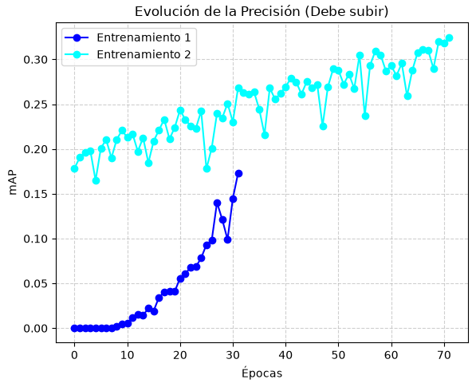

## Práctica 4. Detección de vehículos y matrículas

## Autores: José Miguel Ojeda Hernández (GitHub: https://github.com/JoseOjeda14) y Yenedey Morán Delgado (GitHub: https://github.com/Yenedey36)

## Descripción del Proyecto
El objetivo de esta práctica abarca desde el procesamiento de vídeo para la detección y seguimiento (tracking) de personas y vehículos, hasta la extracción y lectura del texto de las matrículas comparando distintos modelos de OCR.


## 🟢 PARTE 1: Primera Entrega (Detección y Tracking)

### 🔗 Entregables Principales (Parte 1)

* **Vídeo Final:**

Como se puede ver en el vídeo, la técnica basada en contornos resulta ser un método que comete más errores en comparación con el modelo de RT-DETR. Esto ocurre porque los algoritmos clásicos no entienden el contexto de lo que están viendo; se limitan exclusivamente a buscar contrastes de píxeles que formen polígonos de 4 lados con proporciones de rectángulo. Debido a esto, el sistema de contornos genera una alta tasa de falsos positivos, confundiendo frecuentemente faros traseros, rejillas de los vehículos o los parabrisas. Por el contrario, RT-DETR extrae características semánticas profundas, logrando identificar de forma más precisa la matrícula real independientemente de las condiciones de luz, el ángulo o la resolución.

Para llevar el registro del total de vehículos y personas que aparecen en el vídeo, el sistema se apoya directamente en la memoria del algoritmo de seguimiento. Se ha implementado una estructura de datos de tipo conjunto que almacena los identificadores únicos asignados a cada objeto. De esta forma, aunque la red neuronal detecte el mismo coche durante cientos de fotogramas, su ID se registra únicamente la primera vez que entra en escena.Garantizando un conteo acumulativo exacto, evitando que un mismo objeto sea sumado múltiples veces.

Por último para determinar la dirección de los vehículos, se evalúa la memoria espacial de sus centroides sobre el eje Y. El sistema registra la coordenada Y exacta donde un objeto es detectado por primera vez. En cada fotograma, se calcula el vector de desplazamiento restando la posición inicial a la actual: si el valor es fuertemente positivo, el objeto baja por la pantalla, se acerca al Frente, si es fuertemente negativo, el objeto sube, se aleja hacia el Fondo.


*(Nota: En este primer vídeo solo se detectan las matriculas y las 3 tareas extras realizadas, las cuales se explicaran más adelante, por un tema de rendimiento, el vídeo de la deteccion de los caracteres de la matrícula estará más adelante).*
* **Archivo de tracking (CSV):** En `resultados_tracking.csv` se encuentran las detecciones frame a frame de los distintos objetos del video. *(Nota: El texto de la matrícula se rellena en la Parte 2).*
* **Dataset de Matrículas:** https://drive.google.com/drive/folders/1RFd6sKH_QMQcpE_w5rWmy8rKiYUY5_SI

### Tareas Completadas
- Detección y seguimiento de personas y vehículos (clases: `person, car, motorcycle, bicycle, bus, truck, boat, matricula`).
- Detección de matrículas integradas en el pipeline mediante IA.
- Conteo total de objetos detectados por clase a lo largo del vídeo.
- Volcado de datos estructurado en CSV.

### ⭐ Puntos Extra Implementados
1. **Determinación de Flujo:** Implementación de memoria espacial en el eje Y para determinar la dirección. El sistema muestra si los vehículos/personas se están **Acercando** o **Alejando** y contabiliza su paso al cruzar márgenes establecidos en la calzada.

```python
cy = (y1 + y2) // 2 #Centro vertical

            if track_id not in posicion_inicial:
                posicion_inicial[track_id] = cy

            desplazamiento_y = cy - posicion_inicial[track_id]
            
            direccion = "Fijo"
            if desplazamiento_y > 30: 
                direccion = "Frente" 
            elif desplazamiento_y < -30:
                direccion = "Fondo"  

            linea_fondo = 350 
            linea_frente = 400

            if track_id not in ids_contados_flujo:
                if direccion == "Frente" and cy > linea_frente:
                    flujo["Frente"] += 1
                    ids_contados_flujo.add(track_id)
                elif direccion == "Fondo" and cy < linea_fondo:
                    flujo["Fondo"] += 1
                    ids_contados_flujo.add(track_id)
```

2. **Anonimización:** Sistema de pixelado sobre las áreas (ROIs) de personas y vehículos para proteger la privacidad.

```python
if nombre_clase in clases_permitidas:
                y1_safe, y2_safe = max(0, y1), min(height, y2)
                x1_safe, x2_safe = max(0, x1), min(width, x2)
                
                roi = img[y1_safe:y2_safe, x1_safe:x2_safe]
                
                if roi.size != 0:
                    w_roi = x2_safe - x1_safe
                    h_roi = y2_safe - y1_safe
                    roi_small = cv2.resize(roi, (max(1, w_roi//12), max(1, h_roi//12)), interpolation=cv2.INTER_LINEAR)
                    roi_blurred = cv2.resize(roi_small, (w_roi, h_roi), interpolation=cv2.INTER_NEAREST)
                    
                    img[y1_safe:y2_safe, x1_safe:x2_safe] = roi_blurred
```

3. **Técnicas de Contornos para Matrículas:** Función matemática tradicional (`Canny` + `GaussianBlur` + `findContours`) que busca proporciones de matrícula. Se dibuja en **ROJO** ("Mat. Contorno") para compararla visualmente con la precisión del modelo RT-DETR.

```python

def detectar_matricula_contornos(roi_coche):

    gris = cv2.cvtColor(roi_coche, cv2.COLOR_BGR2GRAY)
    gris = cv2.GaussianBlur(gris, (5, 5), 0)
    bordes = cv2.Canny(gris, 30, 200)
    
    contornos, _ = cv2.findContours(bordes, cv2.RETR_TREE, cv2.CHAIN_APPROX_SIMPLE)
    
    contornos = sorted(contornos, key=cv2.contourArea, reverse=True)[:10]
    
    for c in contornos:
        perimetro = cv2.arcLength(c, True)
        aproximacion = cv2.approxPolyDP(c, 0.018 * perimetro, True)
        
        if len(aproximacion) == 4:
            x, y, w, h = cv2.boundingRect(aproximacion)
            aspect_ratio = w / float(h)
            
            if 2.5 <= aspect_ratio <= 5.5:
                return aproximacion 

    return None
```

### Entrenamiento del Modelo (RT-DETR)
Se realizó un *fine-tuning* sobre RT-DETR, conservando las 9 primeras clases de COCO y mapeando la matrícula en el ID 9. 

* **Función de Pérdida (Train Loss):** Descenso pronunciado en las primeras épocas y estabilización progresiva hacia el final del ciclo (época 71), indicando un aprendizaje correcto sin sobreajuste.

> 

* **Métrica de Precisión (mAP):** Mejora continua del mAP@0.5:0.95 alcanzando picos estables, lo que se traduce en una mayor confianza durante la inferencia en el vídeo de test.

> 
